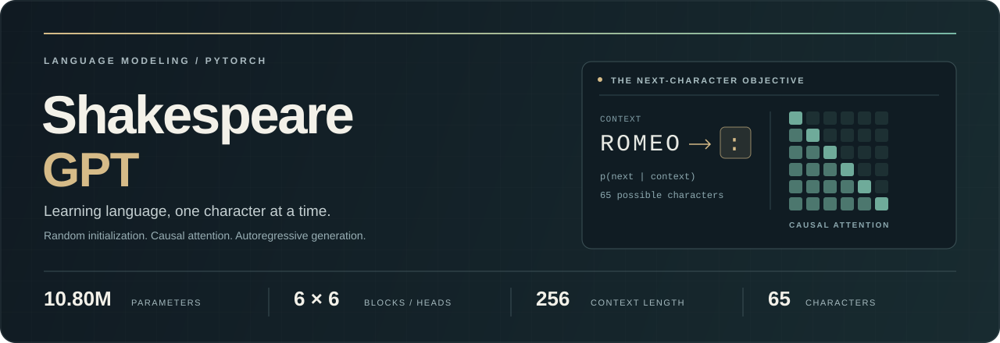
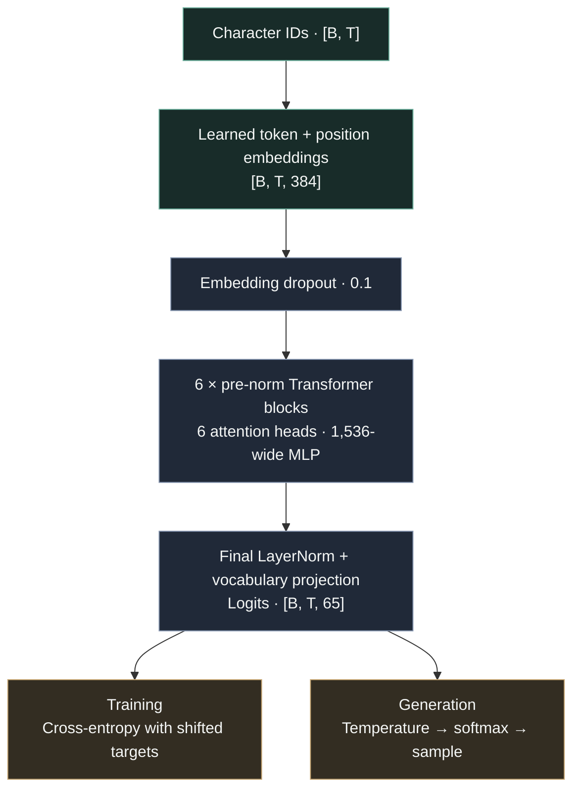

<p align="center">
  
</p>

<h1 align="center">Shakespeare-GPT</h1>

<p align="center">
  <strong>Learning the structure of language, one character at a time.</strong><br>
  A decoder-only Transformer trained from random initialization on Shakespearean text.
</p>

<p align="center">
  <a href="requirements.txt"></a>
  <a href="#dataset-and-tokenization"></a>
  <a href="#model-architecture"></a>
  <a href="#quick-start"></a>
</p>

<p align="center">
  <a href="#project-overview">Overview</a> ·
  <a href="#quick-start">Quick Start</a> ·
  <a href="#model-architecture">Architecture</a> ·
  <a href="#dataset-and-tokenization">Dataset</a> ·
  <a href="#training-and-evaluation">Training</a> ·
  <a href="#engineering-notes">Engineering Notes</a>
</p>

---

## Project overview

Shakespeare-GPT implements the full path from raw text to an autoregressive language model: character tokenization, sequence construction, causal self-attention, gradient-based optimization, held-out evaluation, checkpointing, and text generation.

The model has **10,795,841 trainable parameters** in its default configuration. It learns to predict the next character from up to **256 preceding characters**, including dialogue labels, punctuation, whitespace, and line breaks. Training starts with randomly initialized weights.

The implementation is organized into four focused Python modules. The tokenizer, Transformer composition, training loop, and sampling loop are defined in this repository; attention computation uses PyTorch's `nn.MultiheadAttention`, and differentiation uses PyTorch autograd.

| Engineering area | Implementation |
| :--- | :--- |
| Data representation | A deterministic character-to-integer vocabulary and contiguous corpus split |
| Sequence modeling | Learned token and position embeddings, causal masking, and six pre-norm Transformer blocks |
| Optimization | AdamW, linear learning-rate warmup, dropout, and gradient norm clipping |
| Evaluation | Mean next-character cross-entropy over sampled training and held-out batches |
| Inference | Temperature-scaled multinomial sampling with a sliding context window |
| Execution | Automatic Apple Metal (`mps`) selection with CPU fallback |

## Quick start

### 1. Set up the environment

The commands below use a POSIX shell. Python 3.11 can run the implementation; dependency lower bounds are listed in [requirements.txt](requirements.txt).

```bash
git clone https://github.com/EmircanTanyildiz/Shakespeare-GPT.git
cd Shakespeare-GPT

python3 -m venv .venv
source .venv/bin/activate
python -m pip install -r requirements.txt
```

On Windows, activate the environment with `.venv\Scripts\Activate.ps1` in PowerShell. PyTorch is the runtime ML dependency; NumPy and tqdm are also declared in the requirements, though the current scripts do not import them.

### 2. Train the model

Run commands from the repository root so the relative data and checkpoint paths resolve correctly.

```bash
python train.py
```

Training reads `data/shakespeare.txt`, downloading it from the configured source if it is missing. It selects MPS when available, otherwise CPU, then runs **5,000 iterations** with the defaults in [train.py](train.py).

The terminal reports training loss, held-out loss, learning rate, and elapsed seconds. At evaluation points after iteration zero, it also prints a **200-character continuation** of `ROMEO: ` at temperature `0.7`. A successful run writes the final checkpoint to `checkpoints/model.pt`; a later completed run replaces that file.

> **Device behavior:** CUDA is not selected by the current scripts. An environment without available MPS uses CPU, including a machine with an NVIDIA GPU.

### 3. Generate from a trained checkpoint

After training, run the following Python code from the repository root. This example loads the checkpoint produced by `train.py` and calls the model's generation method directly.

```python
import torch

from dataset import DATA_PATH, CharacterTokenizer, download_shakespeare
from model import GPT

device = "mps" if torch.backends.mps.is_available() else "cpu"
checkpoint = torch.load(
    "checkpoints/model.pt", map_location=device, weights_only=True
)

download_shakespeare()
with open(DATA_PATH, "r", encoding="utf-8") as file:
    tokenizer = CharacterTokenizer(file.read())

model = GPT(**checkpoint["config"]).to(device)
model.load_state_dict(checkpoint["model_state_dict"])
model.eval()

prompt = "ROMEO: "
input_ids = torch.tensor(
    [tokenizer.encode(prompt)], dtype=torch.long, device=device
)
output_ids = model.generate(
    input_ids, max_new_tokens=300, temperature=0.8
)
print(tokenizer.decode(output_ids[0].tolist()))
```

Use a nonempty prompt containing characters present in the corpus and a temperature greater than zero. The decoded output includes the original prompt followed by the requested new characters.

> **CLI status:** The standalone [generate.py](generate.py) entry point needs the compatibility corrections listed under [Engineering notes](#engineering-notes). The example above uses the current training checkpoint format.

## Model architecture

The model is a **decoder-only, pre-norm Transformer**. Every position predicts the next character using its own character and the preceding context. A causal mask blocks attention to later positions.



`B` is the batch size and `T` is the sequence length. During default training, `B = 64` and `T = 256`.

| Component | Default configuration |
| :--- | :--- |
| Vocabulary | 65 character IDs, derived from the corpus |
| Context window | 256 characters |
| Token embeddings | `65 × 384` |
| Learned position embeddings | `256 × 384` |
| Transformer depth | 6 blocks |
| Attention | 6 heads, 64 dimensions per head |
| Feed-forward network | `384 → 1,536 → 384`, with GELU |
| Normalization | LayerNorm before each attention/MLP sublayer, plus a final LayerNorm |
| Regularization | Dropout `0.1` on embeddings, attention weights, and MLP output |
| Output head | Independent linear projection `384 → 65`, including bias |
| Training objective | Next-character cross-entropy |

### Inside a Transformer block

Each block applies attention and a feed-forward network through two residual connections:

$$
h = x + \operatorname{MHA}(\operatorname{LN}_1(x), M)
$$

$$
y = h + \operatorname{Dropout}\!\left(W_2\,\operatorname{GELU}\!\left(W_1\operatorname{LN}_2(h)+b_1\right)+b_2\right)
$$

Here, `M` is the causal mask, and the same normalized input supplies queries, keys, and values. Pre-normalization and residual paths support gradient flow through the stacked blocks. The fourfold MLP expansion adds nonlinear processing at each sequence position.

The Boolean upper-triangular mask is registered as a model buffer and sliced to the current sequence length. It moves with the model and is included in its state dictionary.

<details>
<summary><strong>Parameter accounting and initialization</strong></summary>

Counts below come from the default model with the repository's 65-character vocabulary.

| Component | Trainable parameters |
| :--- | ---: |
| Token embeddings | 24,960 |
| Position embeddings | 98,304 |
| Six Transformer blocks | 10,646,784 |
| Final LayerNorm | 768 |
| Output projection | 25,025 |
| **Total** | **10,795,841** |

Token embeddings and output projection weights are separate. The custom initializer uses a normal distribution with standard deviation `0.02` for embeddings and `nn.Linear` weights, and zeros for linear biases. LayerNorm and the attention module's packed input projection retain their PyTorch initialization.

</details>

## Dataset and tokenization

The project uses the Shakespeare text distributed through [Atil Samancioglu's ShakespeareInput repository](https://github.com/atilsamancioglu/ShakespeareInput). [dataset.py](dataset.py) contains the [raw download URL](https://raw.githubusercontent.com/atilsamancioglu/ShakespeareInput/refs/heads/main/input.txt) and caches the file at `data/shakespeare.txt`. The repository also includes a local copy.

| Property | Value in the included corpus |
| :--- | :--- |
| Text encoding | UTF-8 |
| Total characters | 1,115,394 |
| Distinct characters | 65 |
| Training portion | First 90%: 1,003,854 characters |
| Held-out portion | Remaining 10%: 111,540 characters |
| Split policy | Contiguous, preserving the original text order |
| Token representation | One character per integer ID, stored as `torch.long` |

### From text to prediction targets

`CharacterTokenizer` sorts the unique characters from the full corpus to build its encoding and decoding dictionaries. Capitalization, punctuation, spaces, and newlines remain part of the modeling task. Prompts must use this vocabulary; the tokenizer does not define an unknown-character token.

`getBatch()` samples random starting positions inside one split and constructs pairs of equal-length sequences. Targets are shifted one character ahead of inputs:

```text
Illustrative window

Input:   R  O  M  E  O
Target:  O  M  E  O  :
         └─ predict the next character at every position

Actual training tensors: x.shape = y.shape = (64, 256)
```

Windows can overlap and recur across batches. They remain within their respective split, and training is measured in sampled iterations rather than full-corpus epochs.

The code names the held-out portion `test_data`. Because that portion is evaluated throughout training, it serves as a **validation-style monitoring split**. A separate final test split is not defined.

<details>
<summary><strong>Dataset fingerprint</strong></summary>

The included file contains **1,115,394 bytes** and has this SHA-256 digest:

```text
86c4e6aa9db7c042ec79f339dcb96d42b0075e16b8fc2e86bf0ca57e2dc565ed
```

The download URL follows the upstream `main` branch. Preserve the corpus used for training: checkpoint loading reconstructs the vocabulary from the local text, and changing its character set can change token IDs.

</details>

## Training and evaluation

All training settings are defined near the top of [train.py](train.py). A batch contains **16,384 next-character targets** (`64 × 256`). The model flattens batch and sequence dimensions before computing mean cross-entropy over the vocabulary logits.

| Setting | Default |
| :--- | :--- |
| Batch size | `64` |
| Sequence length | `256` |
| Training iterations | `5,000` |
| Optimizer | `torch.optim.AdamW` |
| Peak learning rate | `3e-4` |
| Warmup | Linear, first `100` iterations |
| Learning rate after warmup | Constant at `3e-4` |
| Gradient clipping | Global gradient norm capped at `1.0` |
| Dropout probability | `0.1` |
| Evaluation cadence | Iteration `0`, every `500` iterations, and final iteration `4,999` |
| Evaluation estimate | Mean loss over `100` random batches per split |
| Training-time sample | Prompt `ROMEO: `, `200` new characters, temperature `0.7` |

### Optimization procedure

Each iteration sets the learning rate, samples a training batch, computes logits and loss, clears gradients, runs backpropagation, clips the gradient norm, and performs an optimizer step.

The learning-rate schedule is:

$$
\eta(t) = 3 \times 10^{-4} \cdot \min\!\left(\frac{t}{100}, 1\right)
$$

Iteration `0` therefore has learning rate `0`; the full learning rate is reached at iteration `100`. AdamW receives all model parameters in one group and uses its default `betas=(0.9, 0.999)`, `eps=1e-8`, and `weight_decay=0.01`.

During evaluation, `model.eval()` disables dropout and `torch.no_grad()` disables gradient tracking. The evaluator averages loss over independently sampled batches, then returns the model to training mode. Training-time text sampling follows the same mode-switching pattern.

### Reading the results

The reported loss measures next-character prediction quality; lower values indicate better prediction on the sampled batches. Character-level perplexity can be derived as `exp(loss)`, though the script reports loss directly. Monitoring both splits helps reveal a widening generalization gap.

The repository does not include a recorded training report or a pretrained checkpoint. A completed run provides the final held-out loss, elapsed training time, generated samples, and model weights. Comparable experiment reports should also record the corpus fingerprint, configuration, random seed, device, and PyTorch version.

<details>
<summary><strong>Checkpoint format</strong></summary>

At the end of training, `checkpoints/model.pt` stores:

| Key | Contents |
| :--- | :--- |
| `model_state_dict` | Learned parameters and registered buffers |
| `iteration` | Configured iteration count, `5,000` by default |
| `test_loss` | Final sampled held-out cross-entropy |
| `config` | `vocab_size`, `embedding_dim`, `num_heads`, `num_layers`, `dropout`, `block_size` |

This is a final inference checkpoint. The optimizer state, random generator states, tokenizer mapping, and full training configuration are not serialized. The training entry point starts a new model each time; it does not resume a prior run or select the best checkpoint automatically.

</details>

## Autoregressive generation

At each step, `GPT.generate()` keeps the most recent 256 characters, runs the model, selects the final position's logits, divides them by temperature, applies softmax, and samples one character with `torch.multinomial`. The sampled character is appended to the sequence before the next step.

| Temperature | Effect on the next-character distribution |
| :--- | :--- |
| `0 < T < 1` | Sharpens the distribution toward higher-probability characters |
| `T = 1` | Uses the model's original softmax distribution |
| `T > 1` | Flattens the distribution and increases sampling diversity |

Sampling uses the full vocabulary. Generation ends after `max_new_tokens` characters; there is no end-of-sequence token. The returned sequence retains the full prompt and generated text even when the model's active context has been cropped. Learned position indices restart at zero within each active window.

The current implementation recomputes the context on every step. It does not maintain a key/value cache or apply top-k or nucleus filtering.

## Repository guide

```text
Shakespeare-GPT/
├── README.md                Project documentation
├── dataset.py               Corpus download, character tokenizer, split, batch sampling
├── model.py                 Transformer blocks, GPT model, loss, autoregressive sampling
├── train.py                 Configuration, optimization, evaluation, checkpoint saving
├── generate.py              Checkpoint loader and interactive generation entry point
├── requirements.txt         Declared Python dependencies
├── data/
│   └── shakespeare.txt      Included corpus; downloaded if missing
├── docs/
│   └── assets/
│       └── hero.svg         README cover artwork
└── checkpoints/             Created by training
    └── model.pt             Written after a completed training run
```

To inspect the implementation, follow **`dataset.py → model.py → train.py`**. The generation loop itself is `GPT.generate()` in [model.py](model.py).

## Engineering notes

### Generation CLI integration

[generate.py](generate.py) contains example prompts and an interactive prompt loop. Two mismatches currently prevent it from completing successfully with the checkpoint produced by `train.py`:

| Location | Current behavior | Required correction |
| :--- | :--- | :--- |
| `load_model()` | Reads the absent `checkpoint['val_loss']` key | Read `checkpoint['test_loss']` |
| `generate()` | Passes `output_ids[0]` directly to the tokenizer | Decode `output_ids[0].tolist()` |

The [quick-start example](#3-generate-from-a-trained-checkpoint) uses the compatible checkpoint structure and decoding path.

### Design trade-offs

- **Character-level modeling** keeps vocabulary construction transparent and preserves text formatting. A 256-character window covers less semantic context than a similarly sized subword-token window.
- **Explicit PyTorch modules** make tensor shapes, masking, residual paths, and optimization easy to inspect. The implementation prioritizes a readable training pipeline and uses dense attention throughout.
- **A contiguous holdout** preserves text order and keeps sampled windows inside one split. Its position at the end of the corpus can expose the model to a different mix of scenes or speakers.
- **Simple inference checkpoints** contain enough model configuration to reconstruct the network. Reproducible training continuation would also require optimizer, tokenizer, and random generator state.
- **Stochastic execution** affects initialization, batch sampling, dropout, and generated text. The scripts currently do not set a random seed or configure deterministic execution.

### Next engineering steps

Potential extensions to the current implementation:

- [ ] Align the generation CLI with the training checkpoint and tokenizer interfaces.
- [ ] Serialize the vocabulary, full training configuration, and random generator states.
- [ ] Add periodic checkpoints, best-loss selection, and training resume support.
- [ ] Introduce configuration files or command-line flags, reproducible seeds, and CUDA selection.
- [ ] Record loss curves, hardware/runtime metadata, and fixed-prompt samples for completed experiments.
- [ ] Explore key/value caching and top-k or nucleus sampling for inference.

## References

- [ShakespeareInput](https://github.com/atilsamancioglu/ShakespeareInput) — the text source configured in this project.
- [Attention Is All You Need](https://arxiv.org/abs/1706.03762) — the original Transformer paper and background on attention-based sequence modeling.
- [PyTorch MultiheadAttention](https://docs.pytorch.org/docs/stable/generated/torch.nn.MultiheadAttention.html) — the attention module used inside each block.
- [PyTorch AdamW](https://docs.pytorch.org/docs/stable/generated/torch.optim.AdamW.html) — the optimizer used by the training loop.

---

<p align="center">
  Built by <a href="https://github.com/EmircanTanyildiz">Emircan Tanyildiz</a><br>
  <sub>Character-level language modeling · PyTorch · Transformer architecture</sub><br><br>
  <a href="#shakespeare-gpt">Back to top ↑</a>
</p>
